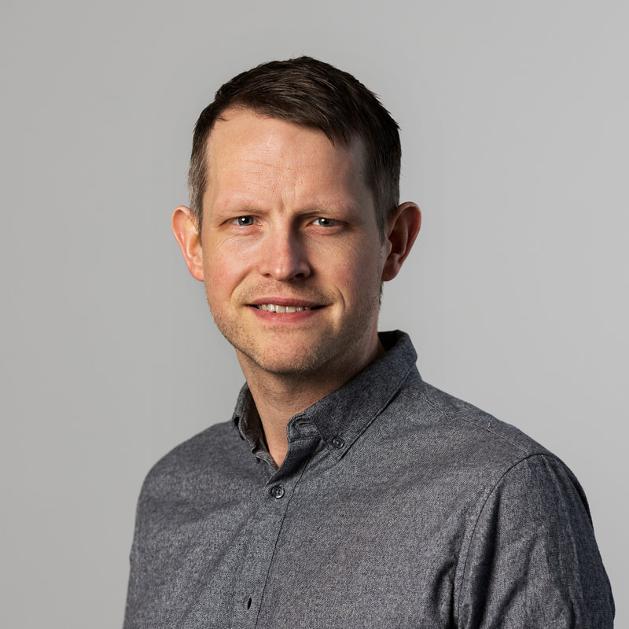

::: {.wrap}

```{=html}
<section class="hero">
  <div class="hero-text">
    <h1 class="hero-name">Björn Thor<br>Arnarson</h1>
    <p class="hero-lead">International economist at the <a href="https://en.rockwoolfonden.dk/employees/bjorn-thor-arnarson/">ROCKWOOL Foundation Research Unit</a> in Copenhagen. I study global value chains, innovation and knowledge spillovers, using firm-to-firm trade data linked to Danish and Swedish employer–employee registers.</p>
    <p class="hero-sub">Icelandic, living in Sweden · Affiliated researcher, Lund University · CESifo affiliate</p>
    <div class="hero-links">
      <a class="hero-mail" href="mailto:bth@rff.dk"><svg class="ico ico-lead" aria-hidden="true"><use href="#i-mail"></use></svg>bth@rff.dk</a>
      <a class="pill-link hero-cv" href="files/Arnarson_CV.pdf"><svg class="ico ico-lead" aria-hidden="true"><use href="#i-pdf"></use></svg>CV (PDF)</a>
      <span class="icon-row">
        <a class="icon-btn" href="https://scholar.google.se/citations?user=RM3pq-gAAAAJ&hl=en" aria-label="Google Scholar" title="Google Scholar"><svg class="ico" aria-hidden="true"><use href="#i-scholar"></use></svg></a>
        <a class="icon-btn" href="https://ideas.repec.org/f/par416.html" aria-label="RePEc/IDEAS" title="RePEc/IDEAS"><svg class="ico" aria-hidden="true"><use href="#i-repec"></use></svg></a>
        <a class="icon-btn" href="https://orcid.org/0000-0003-4981-8965" aria-label="ORCID" title="ORCID"><svg class="ico" aria-hidden="true"><use href="#i-orcid"></use></svg></a>
        <a class="icon-btn" href="https://www.linkedin.com/in/bjornthor/" aria-label="LinkedIn" title="LinkedIn"><svg class="ico" aria-hidden="true"><use href="#i-linkedin"></use></svg></a>
        <a class="icon-btn" href="https://x.com/bjorci" aria-label="X" title="X"><svg class="ico" aria-hidden="true"><use href="#i-x"></use></svg></a>
        <a class="icon-btn" href="https://bsky.app/profile/bjorci.bsky.social" aria-label="Bluesky" title="Bluesky"><svg class="ico" aria-hidden="true"><use href="#i-bluesky"></use></svg></a>
      </span>
    </div>
  </div>
  
</section>
```

::: {.sec .reveal}
::: {.label}
## Current research

[Working papers and work in progress. With abstracts →](research.qmd#type=current)
:::
::: {#home-current}
:::
:::

::: {.sec .reveal}
::: {.label}
## Publications

[With abstracts →](research.qmd#type=publication)
:::
::: {#home-pub}
:::
:::

::: {.sec .reveal .home-quiet}
::: {.label}
## News & talks

[All news and talks →](news.qmd)
:::
::: {}
::: {#upcoming}
:::

::: {#latest}
:::

::: {#linkedin}
:::
:::
:::

::: {.sec .reveal}
::: {.label}
## The Øresund region
:::
::: {}
```{=html}
<a class="region-card" href="about.html#oresund">
  
  <span class="region-text">
    <span class="t">One labour market across the strait</span>
    <span class="n">Much of my research uses Danish and Swedish register data linked across the border, and the opening of the bridge as a natural experiment. Read more →</span>
  </span>
</a>
<p class="region-credit">Photo: <a href="https://commons.wikimedia.org/wiki/File:%C3%96resundsbron_October_2017_02.jpg">Arild Vågen</a>, <a href="https://creativecommons.org/licenses/by-sa/4.0">CC BY-SA 4.0</a></p>
```
:::
:::

:::
